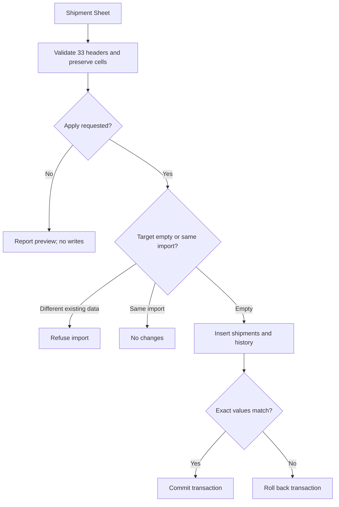
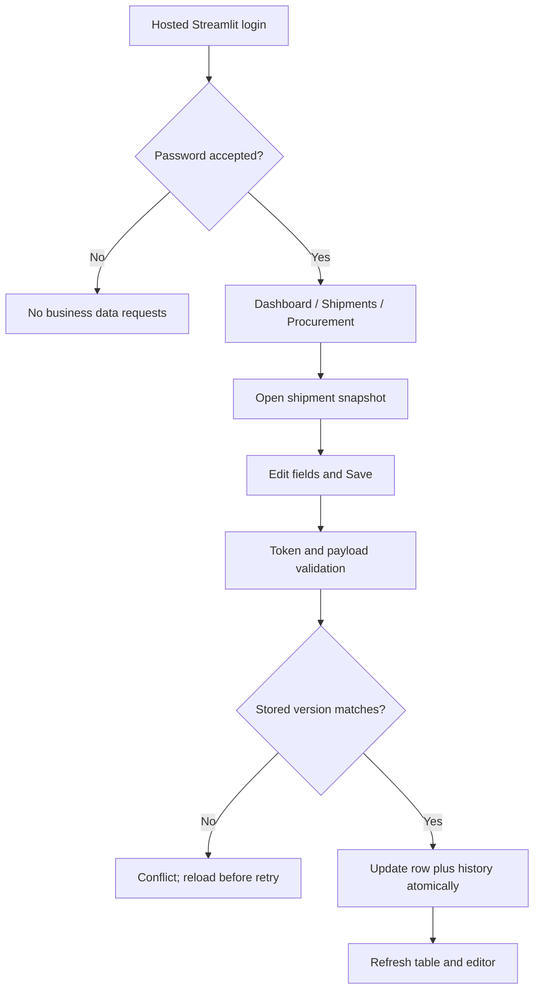
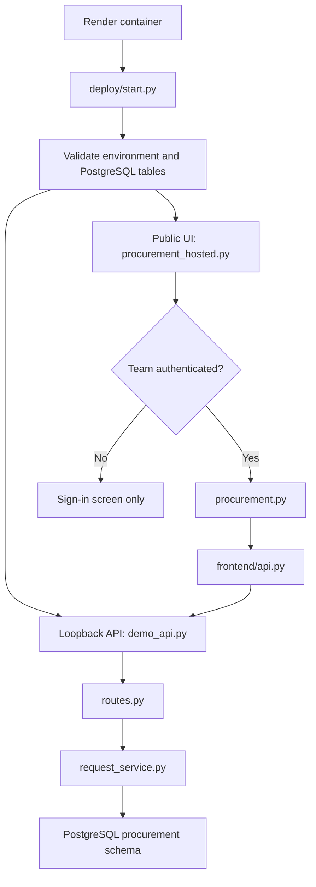
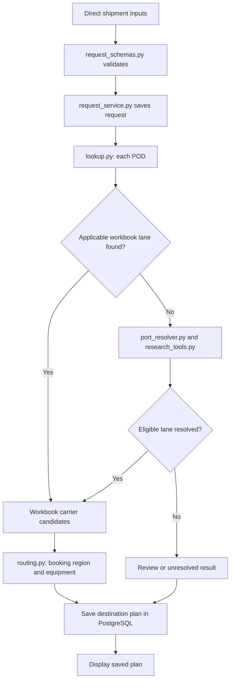
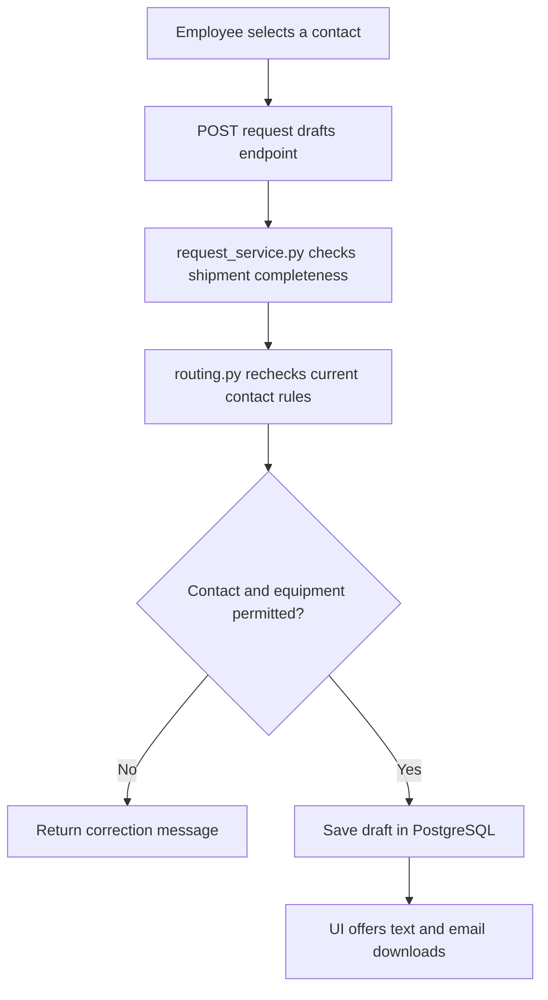
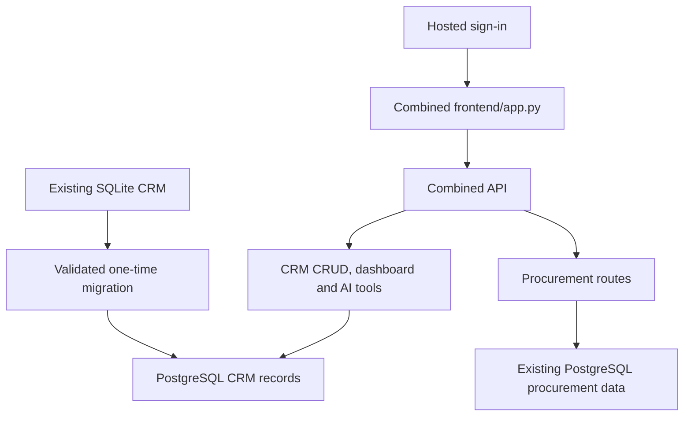
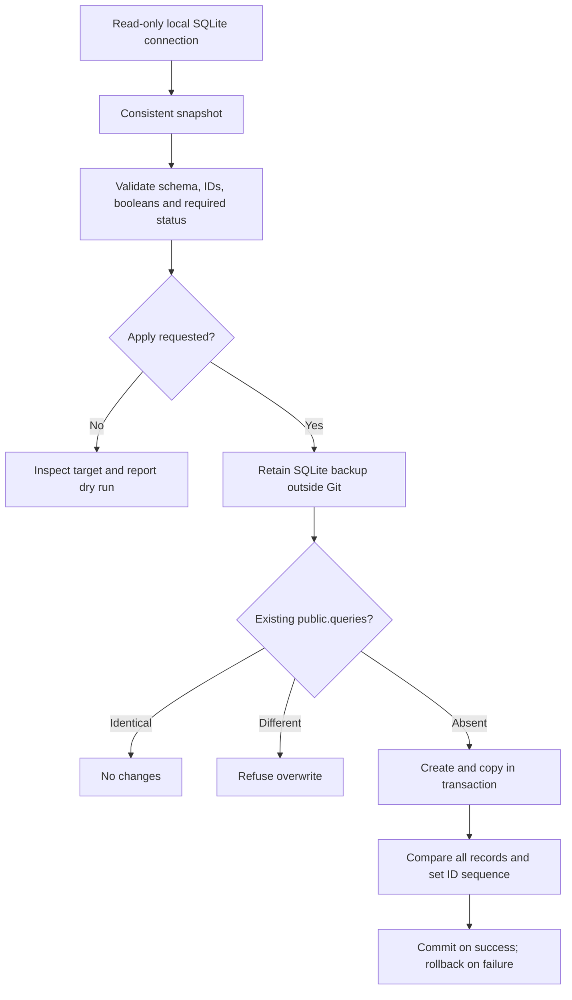

# Code flow and product impact — 21 October 2026

This patch is implemented and locally tested, not yet deployed. Only Shipment Sheet is in scope.

## Initial source import

`import_workbook.py` reads only SHIPMENT SHEET. `store.py` uses operations tables through the existing PostgreSQL connection. The original workbook, Transport Sheet, old SQLite enquiries and procurement tables remain unmodified. Duplicate serial numbers receive separate UUIDs. Date text stays text; cached formula values retain provenance. Reimporting a changed workbook is refused once daily records exist.

## Hosted interaction and edits

`frontend/shipments.py` calls `/shipments`. `routes.py` validates field names and lengths; `service.py` updates only supplied fields using ID plus version. Two editors cannot silently overwrite the same version. All staff see committed changes after their next refresh. There is no live-push notification or background Excel sync.

## Deployment and existing procurement

`deploy/start.py` checks procurement and operations tables, generates the shared internal API token, starts `app.operations_api:app` on loopback, then starts `frontend/procurement_hosted.py` on Render's public port. The existing team login protects the full UI. The combined API retains the existing procurement router and adds the shipment router. Neither old `app.main` nor SQLite is imported into this hosted process.

| Before | After |
|---|---|
| Procurement-only hosted view | Shipment dashboard, search/add/edit, and procurement in one login |
| Daily data maintained outside the deployed app | Initial import followed by edits saved in PostgreSQL |
| Old 228 enquiries proposed for migration | Superseded; 468 operational shipment rows from supplied workbook |
| Serial numbers risk being treated as keys | Internal UUIDs preserve repeated source serials |
| Concurrent edits could overwrite a colleague | Version mismatch produces a conflict message |
| Enquiry AI tools query the retired model | Old assistant excluded from new hosted view; procurement AI unchanged |

## Current limits

Shared password means history is not attributable to named users. Dashboard shows count, not inferred shipment milestones. Source date review remains necessary. New-record retries after network timeout require checking whether the first save succeeded. No transport, export screen, daily Excel synchronization, history browsing, portal automation, external email sending or commercial features are added.

## Previous flow history (earlier scope; superseded where noted above)

# Code flow and product impact

Last updated: 17 October 2026
Status: current confirmed deployment is procurement-only. Combined CRM migration/integration is planned.

## Current hosted request flow

Effect: the hosted app currently displays procurement after sign-in. `frontend/app.py` contains the CRM tabs but is not the hosted entry point. `app/main.py` contains CRM endpoints but is not the API launched by this deployment.

## Procurement planning

The search-assisted fallback determines port geography and selects an eligible existing lane. It does not prove that a shipping line currently serves that POD, confirm transshipment, or retrieve a price. The UI must retain coverage and review flags.

## Draft preparation

Effect: downloads prepare an enquiry. They do not send mail. Portal-only candidates do not become email enquiries merely because the user selects them.

## Why the CRM is absent from the live app

| Concern | Existing CRM | Current hosted procurement |
|---|---|---|
| Frontend entry | `frontend/app.py`: Dashboard, Freight Queries, AI Assistant, Procurement | `frontend/procurement_hosted.py`: login and Procurement |
| API entry | `app/main.py` | `app/procurement/demo_api.py` |
| Database module | `app/database.py`, configured by `DATABASE_URL` | `app/procurement/pg_database.py`, configured by `PROCUREMENT_DATABASE_URL` |
| Data | Existing local SQLite enquiry records | Migrated PostgreSQL reference data, requests and drafts |
| AI dependencies | `app.ai.agent` and its tools, not included in supplied ZIPs | Search-assisted port resolver and Groq configuration supplied |

Switching only the screen does not supply the missing CRM endpoints, database records or dependencies.

## Planned integration — not current behavior

| Planned code change | Product behavior after verification |
|---|---|
| CRM migration script | Existing enquiries appear in the hosted CRM with preserved identity. |
| `app/database.py` connection configuration | CRM reads/writes persistent PostgreSQL data. |
| Hosted frontend gate and `frontend/app.py` | All four tabs are available after sign-in. |
| `deploy/start.py` and combined API health check | Launcher starts and monitors the combined application. |
| API authentication and `frontend/api.py` headers | CRM and procurement calls use the same internal access boundary. |
| Dependencies based on actual agent imports | AI Assistant can start and use its intended CRM tools. |

The existing procurement data must be preserved. The CRM migration must validate source/target records and retain the SQLite backup. No migration has been executed by these documentation files.

## Update rule

For each future patch, update the affected flow diagram and add a file-to-product-impact row. Label unimplemented behavior as planned, test-only paths as tests, and user-confirmed live behavior separately from local checks. Add the corresponding reason and necessity assessment to `CODE_CHANGELOG.md`.

## New migration command — prepared, not executed on company data

`app/migrate_crm_postgres.py` reads `PROCUREMENT_DATABASE_URL` by default only to select the same PostgreSQL database. It writes the CRM table in `public`, not in the existing `procurement` schema. Its execution does not switch the application from SQLite. That switch belongs to the pending combined application patch.

Operational cutover: stop SQLite edits, run the final migration, switch the verified CRM connection/startup, and check saved enquiries and dashboard counts before resuming edits. The migration is not a continuous sync service.
